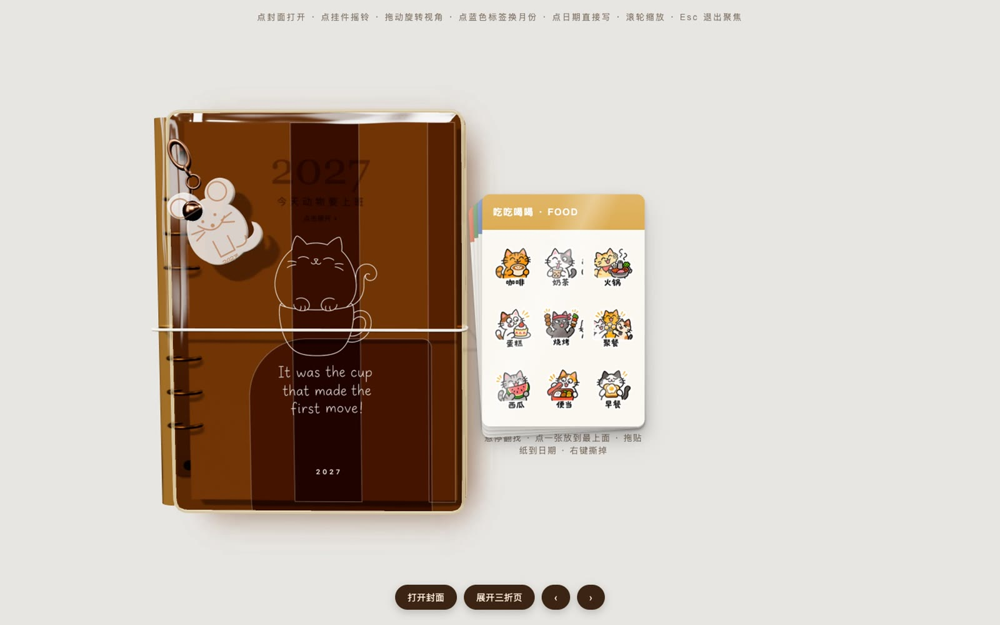
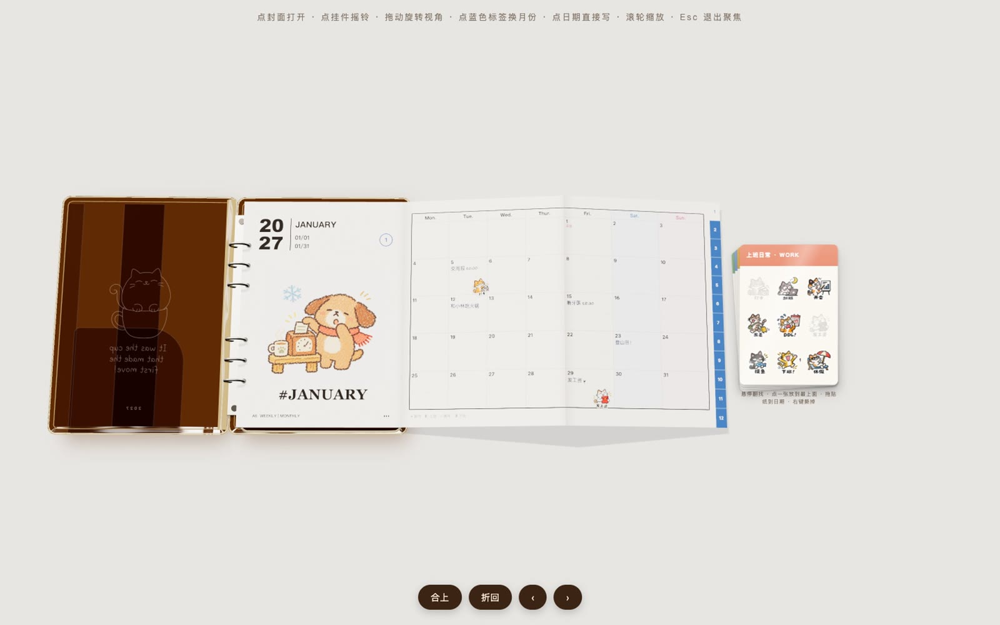

# 今天动物要上班！· 2027 3D 手账本

一本在浏览器里就能翻、能写、能贴的 3D 手掌本。咖啡色透明软胶外壳，三折页月计划，蜡笔风打工猫贴纸，还有一只摇一摇会响铃的小老鼠挂件。




## 玩法

- **看质感**：移动鼠标，本子会跟着轻轻倾斜，透明软壳上的高光随之流动
- **摇一摇**：合上状态下按住封面拖动，挂件甩起来，铃铛叮当响；点挂件也会响
- **打开**：点封面或「打开封面」，再点「展开三折页」，月历一折一折展开
- **写月计划**：点任意日期，镜头拉近到整张月历，直接在格子里写；回车保存，Esc 退出
- **贴贴纸**：鼠标悬停右侧贴纸会扇开翻找，点一张放到最上面，按住贴纸拖到日期上；右键撕掉
- **换月份**：点右侧蓝色 1–12 标签，或底部 ‹ ›
- **滚轮**：控制镜头远近

计划和贴纸保存在你自己浏览器的 localStorage 里，不会上传。

## 本地运行

贴图需要通过本地服务器加载，不能直接双击打开：

```bash
python3 -m http.server 8765
```

然后打开 http://localhost:8765

## 技术

- [Three.js](https://threejs.org/) 0.160（CDN 引入，单个 HTML 文件，无需构建）
- 软胶外壳：`MeshPhysicalMaterial` 透射 + 厚度吸收着色 + 低频法线扰动 + 热压包边
- 日历、手写字、贴纸全部绘制在 Canvas 贴图上
- 音效（铃铛、翻页、撕贴纸、写字）用 Web Audio 实时合成

## 素材

插画、贴纸、封面线稿均为 AI 生成的原创图像。
